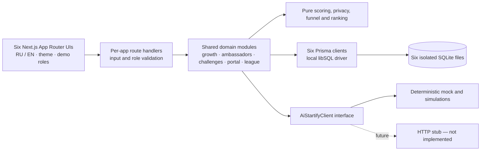

# AI Startify · Global growth lab

Six independent bilingual MVPs for the AI Startify Global Growth Challenge. All screens visibly identify **demo data**. No application is connected to AI Startify, a real advertising system, a messaging service or a student database. No API keys are required.

## Самый простой запуск / Quick demo

```sh
pnpm demo
```

Open `http://localhost:3000` in the browser on the machine running the project. The demo hub starts missing applications, shows readiness, sets demo roles and opens all six products in one window. The large **Open the 3D globe** button opens Global Impact; **All demos** returns to the product list. No sign-up or manual database setup is needed.

In the managed Cloud environment use Chrome inside **Desktop** with `http://127.0.0.1:3000`. This is one landing page, not a published Internet address; the app frames use ports 3001–3006. On your own computer, `pnpm demo` also opens the default browser when supported.

For a fresh checkout: install Node 24 and pnpm 11.25.0, then run `pnpm install --frozen-lockfile` once before `pnpm demo`. The launcher uses development mode by default so edits appear immediately; `DEMO_PRODUCTION=1 pnpm demo` uses existing production builds. Stop the launcher with Ctrl-C to stop the services it started; previously running applications are retained.

## Install and run

Requires Node **24** and **pnpm 11.25.0** (`corepack enable` on machines where Corepack is installed).

```sh
pnpm install --frozen-lockfile
pnpm dev:growth       # 3001 — campaigns, referrals and analytics
pnpm dev:ambassador   # 3002 — adult ambassadors, tasks and rewards
pnpm dev:challenge    # 3003 — teams, judging and frozen results
pnpm dev:portal       # 3004 — school clubs, lessons and reports
pnpm dev:league       # 3005 — public league and founder cards
pnpm dev:globe        # 3006 — offline 3D global impact observatory
# Or run all six:
pnpm dev:all
```

Each development command generates its app's Prisma client, applies checked-in local SQL migrations and seeds SQLite **only when empty**. Repeating it preserves your demo changes. Each app has its own `apps/<name>/prisma/demo.db`; processes need restarting after restoring a cloud snapshot. The role menu is demo authentication, backed by a separate HTTP-only cookie for each app. Cookie names are isolated across ports. Select an editing role before simulating or submitting.

The cloud machine has a read-only home directory. In that environment, set these before installation (reusable environment instructions also contain them):

```sh
export XDG_DATA_HOME=/workspace/.local/share
export XDG_CACHE_HOME=/workspace/.cache
export npm_config_cache=/workspace/.npm
export NEXT_TELEMETRY_DISABLED=1
```

Copy `.env.example` only if local overrides are needed. `LLM_PROVIDER=mock` is the default. Live OpenAI/Anthropic providers deliberately return an implementation error, rather than pretending to send a request.

## Checks

```sh
pnpm db:prepare      # needed before tests/type checks in a clean checkout
pnpm test
pnpm test:coverage  # pure logic and server workflows; threshold >=80%
pnpm build          # all six production builds, sequential to limit memory
pnpm lint           # ESLint + all six strict TypeScript checks
pnpm smoke          # boots each production app, checks routes and functional APIs
pnpm smoke:browser       # original campaign/PNG browser checks
pnpm smoke:globe-browser # globe, feedback, offline and accessibility checks
```

HTTP smoke checks routes, independent role cookies, actual simulation changes and CSV responses. The lightweight browser check uses native CDP, without an E2E framework: it submits a campaign form, verifies three generated variants, changes language/theme, checks a 390px viewport and downloads a PNG with a valid signature and 1200×760 dimensions. Browser tests require local Chromium; other workflows do not.

Unit and database integration suites cover public text validation, attribution, CPA, compliance, ledger approvals, fraud review recovery, reward rules, scores, badges, team identity validation, consent gating, CSV import, owning-school selection, frozen results and season history. Temporary workflow databases are separate from demo databases. See [verification evidence](docs/VERIFICATION.md) for measured outcomes and limits.

## 60-second demos

| Product                                                  | Demo                                                                                                                                                             | Roles                          |
| -------------------------------------------------------- | ---------------------------------------------------------------------------------------------------------------------------------------------------------------- | ------------------------------ |
| [Growth engine](apps/growth-engine/README.md)            | Uzbekistan → parents → Instagram → Russian → create three variants → open tracked link → simulate → analytics → CSV. Try a paid student audience to see a block. | growth-manager, viewer         |
| [Ambassador network](apps/ambassador-platform/README.md) | Join with 18+ confirmation → copy link → simulate → submit task → admin approval → level up → redeem. A burst triggers review and pauses points.                 | ambassador, admin              |
| [Startup challenges](apps/challenge-platform/README.md)  | Create a challenge → add a team using START-001 and two nickname,country rows → simulate → judge → close → showcase.                                             | student, teacher, judge, admin |
| [School studio](apps/school-portal/README.md)            | Register → create class → confirm consent → import nickname CSV → simulate → lesson kit → save/report CSV → partner status update.                               | teacher, partner-manager       |
| [School league](apps/school-league/README.md)            | Join with START-001 → publish a safe founder card → see +11 school points → download PNG → freeze season → begin new season, keeping history.                    | visitor, student, teacher      |

`START-001` through `START-020` are demo school codes. Challenge seeds use eight of those schools. Portal classes use their own `CLUB-…` codes and remain inactive until consent. Each app is independent: registering a school in the portal does not register it in the other mock databases.

## Global Impact dashboard

The sixth app combines an offline 3D globe,13-month expansion timeline,five distinct direction layers,fictional community remarks,a sortable fallback table and presenter mode. Run `pnpm dev:globe` on3006. See the [dashboard README](apps/global-dashboard/README.md) for its60-second demo and [verification](docs/GLOBE_VERIFICATION.md) for current checks.

## Architecture



See [architecture](docs/ARCHITECTURE.md), [decisions](docs/DECISIONS.md) and [plan](docs/PLAN.md).

## What is mocked and what persists

All platform registrations, progress, referral attribution and generated copy are simulated. SQLite persists local campaigns/events, approvals, append-only points, task proofs, school consent attestations, nickname rosters, reports, judge scores, snapshots and projects. Referral links resolve locally and record local visits; there is no external sending. Certificates/passports and the decorative QR on the founder card are explicitly demo artifacts, not verification services. PNG is generated locally with Canvas and system fonts.

Reports retain a current progress snapshot labelled by a selected month; they do not reconstruct historical monthly activity. Frozen challenges and old seasons retain fixed results. League scoring is `started + 10 × published`; publishing creates both one started and one published project, worth 11 points. Challenge auto progress normalizes to 0–100 before applying configured judge/auto weights. A published project remains started for counting purposes.

## Privacy and real integration

Students use opaque IDs and invented nicknames only. Public text is checked for email addresses, phone-like strings and obvious full-name patterns. This is a conservative heuristic, not an identity classifier: use handles such as `Nova42` and project names such as `eco orbit`. No student name, contact, photo or exact-address fields exist. Ambassadors confirm 18+; schools attest to parental consent before codes activate. Paid student/minor campaigns are blocked server-side even if the form is tampered with. Mandatory age/PII campaign rules cannot be disabled.

Replace `HttpAiStartifyClient` methods in `packages/shared/src/index.ts` using the actual upstream API contract, then inject that implementation in `makeService`. Authenticate and verify incoming events before granting progress or points. Add real identity, school ownership, consent auditing, abuse controls and secret bindings before external deployment. The demo role menu and public event ingestion are intentionally local demonstration mechanisms.

ECC workflows from [affaan-m/ecc](https://github.com/affaan-m/ecc) were applied after the user's request: test-first regressions, independent reviewers, domain modularization, coverage and verification. No ECC hooks or global configuration were installed.
