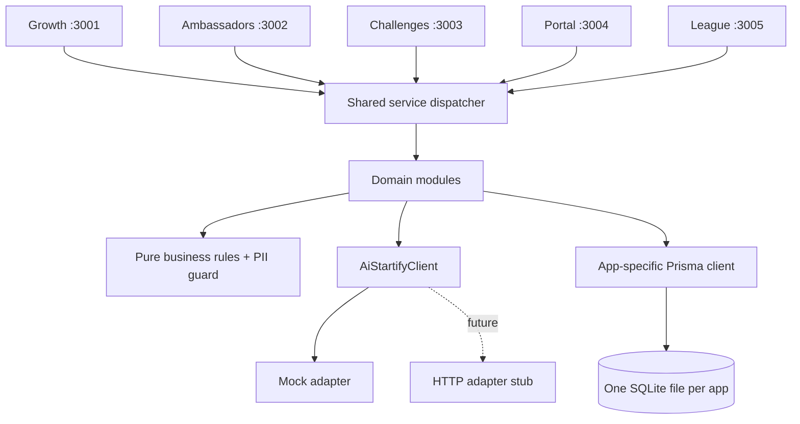

# Architecture

Each app is a standalone Next.js App Router service with its own generated Prisma client, checked-in SQLite migration, local database and fixed port. The dynamic page route asks its domain service for a serializable view. The shared React UI renders bilingual forms, tables, rankings and cards; mutations go through per-app JSON handlers. Shared code is source-transpiled by Next.

The app boundary is the database/client supplied to makeService. No service opens another app's database. Apps depend on the AiStartifyClient contract; simulation helpers build mock progress then read it through the contract. There is no claim of upstream data access.

Campaign events retain referral codes for attribution. Ambassador balance is only the sum of immutable ledger rows; review, redemptions and awards use transactions. A zero-value review ledger entry marks the boundary after which referral fraud is reconsidered. Challenges store progress snapshots, criterion scores and immutable final ranking JSON when closed. The portal updates only consent-enabled active classes and snapshots report data. League snapshots belong to a season; rollover adds a fresh set and retains older rows.

Startup regenerates Prisma clients, applies local SQL migrations in a transaction and seeds empty databases. The official libSQL adapter and JS schema engine avoid downloading native Prisma engines. Runtime processes are not part of a reusable cloud snapshot; use the saved start instructions to relaunch them.

Demo authentication is an app-specific HTTP-only SameSite=Strict role cookie. Roles are validated on mutations; same-origin POST checks compare Origin and Host. This is designed for local demonstrations, not public authentication. Public referral/event routes are simulated and need authenticated provenance for production.
